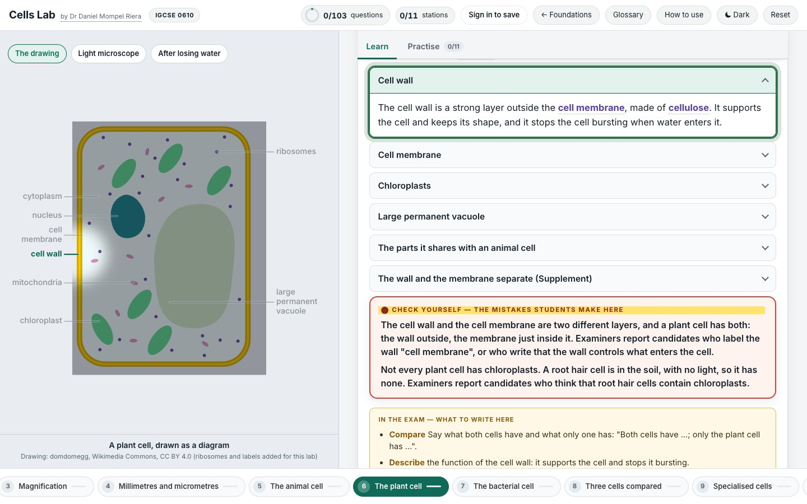

<div align="center">

<h1>🔬 &nbsp;Cells Lab</h1>

**Cambridge IGCSE Biology 0610 · Topic 2, Organisation of the organism**

[](https://nlcsbiology.com/cells-lab/)


by **Dr Daniel Mompel Riera** · NLCS Jeju

</div>



---

## What a student does

Each station has its own picture on the left, and short cards on the right that open one at a time. Press a part
of the picture and its card opens; open a card and its part lights. Then the questions say right or wrong, never
the answer.

|  |  |
|---|---|
| 🔬 **11 stations** | from body to cell · the light microscope · magnification · millimetres and micrometres · the animal cell · the plant cell · the bacterial cell · three cells compared · specialised cells · drawing what you see · measuring a cell |
| ✍️ **103 questions** | fill the gaps · multiple choice · put in order · match up · sort into groups · tick a grid · drag the words · **press the part on a real photograph or drawing** |
| 🧍 **From a body to one cell** | the Foundations shelf's real woman, from her whole body to one cell, one level at a time; and a plant the same way |
| 🔭 **A real microscope** | follow the light from the lamp to the eye, turn the nosepiece and focus a real nerve cell at ×40, ×100 and ×400 |
| 📏 **Sizes you can see** | a cell that grows on a slider while its actual size never changes; a ruler that zooms from 1 mm to 5 µm, with real tissue, a mitochondrion and bacteria on it at their true scale |
| 🧫 **Each cell seen three ways** | the drawing, the light microscope and the electron microscope: a part you cannot see with one opens the one that shows it, and says why |
| ✏️ **Drawing and measuring, never the report** | the rules of a biological drawing, found by spotting them broken, and the counting method on a different specimen: the lab never shows the specimen of the assessed practical |
| 📖 **A shared glossary** | one wording per term, the same in every lab |

> [!NOTE]
> **The answers are not in the page — at all.** The lab can tell a student they are wrong, but
> nothing in it knows what *right* is. How that works is explained below.

## Where it sits

Behind the [Foundations](https://nlcsbiology.com/foundations-hub/) shelf (Topic 2), one shelf of the
[Biology Hub](https://nlcsbiology.com/biology-hub/) — the front door to every Biology app here.
The **← Foundations** button goes back up.

<details>
<summary><b>Behind the scenes</b> — how this lab works, in plain English</summary>

<br>

**Real pictures.** Every photograph is a real specimen: micrographs from the Berkshire Community College Bioscience
Image Library, Mikael Häggström, the NIAID and Dartmouth College, the HeLa cell from Janelia's OpenOrganelle, and the
woman's body from the HuBMAP Human Reference Atlas. The three cell drawings are domdomegg's (CC BY 4.0), with the
ribosomes added. Every label is placed on its part from the picture itself, and the label lines never cross.

**Why the answers are not in the page.** Each question carries a *scrambled fingerprint* of its
answer. When a student answers, the page scrambles what they did in the same way and compares the
two. Scrambling only works one way, so nothing in the page can say what the right answer is — only
*not that one*. The real answers live in one file that is never published.

**What is shared with the other labs.** The question engine, the marking, the saving, the sign-in,
the widgets and the glossary are kept in one place and copied in whenever a lab is rebuilt, so a fix
reaches every lab at once. What belongs to this lab alone is its content and its pictures.

**Rebuilding it** (only needed if you change the content). One command reads the master file with
the answers in it and writes out the published version with only the fingerprints. It refuses to
finish unless every answer still marks correctly.

```
node tools/build.mjs
```

Picture credits: [`assets/photos/CREDITS.md`](assets/photos/CREDITS.md).

</details>

Made by **Dr Daniel Mompel Riera** · Biology, NLCS Jeju ·
[dmompelriera@nlcsjeju.kr](mailto:dmompelriera@nlcsjeju.kr)

## Licence

| What | Licence |
|---|---|
| **The software** — everything that runs: JavaScript, HTML structure, CSS, build tools | [AGPL-3.0](LICENSE) |
| **The teaching material** — question text, explanations, diagrams and images I made, wherever they are stored | [CC BY-NC-SA 4.0](LICENSE-CONTENT) |

**In plain English.** Use it, change it, run it for your students — free, and you never need to ask.
If you change the software and let anyone else use it, *including over a network*, you have to publish
your source under the same licence. You may not sell the teaching material or use it commercially, and
the credit has to stay.

**Not covered:** third-party images and media keep their own licences — see the picture credits.

© 2026 Dr Daniel Mompel Riera. I hold the copyright, so I can grant other terms: if you want to use any of
this commercially, ask me at <dmompelriera@nlcsjeju.kr>.
